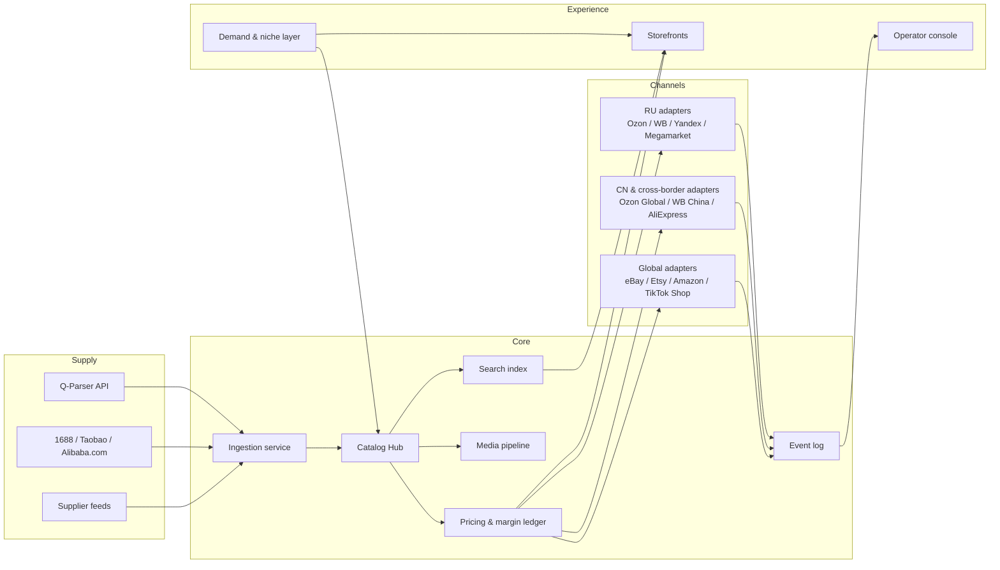

# Architecture overview

> Status: proposed, 2026-11-22. Platform decision is still open (research track `platforms`).
> This document fixes the boundaries that do not depend on the platform choice.

## 1. What we are building

A catalogue-to-channel platform:

1. **Ingest** supplier catalogues through Q-Parser (and later other supply adapters).
2. **Normalise** them into a canonical product model with attributes, media, categories and cost.
3. **Price** them with a margin ledger that knows marketplace commissions, delivery, returns,
   acquiring and tax.
4. **Publish** them to owned storefronts and to marketplace sales channels.
5. **Sync** price, stock, orders and returns back, with an audit trail.
6. **Research** demand and niches before a storefront or a category is created.

The first storefronts are ours. The same core is designed so that later it can sell ready-made
storefronts and host them for clients (multi-tenant SaaS).

## 2. System context



## 3. Planes and responsibilities

| Plane | Responsibility | Must not |
|---|---|---|
| Supply | Talk to Q-Parser, 1688, feeds; raw capture | Know about storefronts or marketplaces |
| Catalog | Canonical product/variant/offer, attributes, categories, media | Contain channel-specific fields |
| Commerce | Price, stock, cart, checkout, orders, returns | Talk to marketplace APIs directly |
| Channels | Publish and sync per marketplace | Contain pricing policy |
| Demand | Keywords, niches, seasonality, competition | Write to the catalogue without a proposal |
| Knowledge | Corpus, wiki, graph, claims, decisions | Be the runtime source of truth |
| Ops | Jobs, observability, reconciliation, backups, secrets | Be bypassed by ad-hoc scripts |

## 4. Region packs: `ru`, `cn`, `global`, `cis`

A region pack is a versioned bundle of channel profiles and local rules. It contains:

- marketplace capability profiles (auth, endpoints, limits, moderation);
- category taxonomy mapping and attribute dictionaries;
- currency, tax and settlement rules;
- language and content rules;
- legal/entity requirements and prohibited categories;
- logistics and fulfilment models (FBO/FBS/DBS, cross-border).

The shared kernel never branches on a country name. It resolves a **profile** and calls the
adapter port. This is the only way to keep RU, CN and global connectors from turning the core
into a pile of `if platform == ...`.

## 5. Anti-corruption layer

Q-Parser is an external system with its own vocabulary (`goods`, `parser`, `export`, `data`).
It never leaks into the domain:

```text
Q-Parser DTO -> QParserAdapter -> SourceProduct -> CanonicalProduct
```

The adapter owns:

- HTTP client, auth, retries, pagination, polling;
- mapping Q-Parser `data` keys to canonical attributes;
- error translation (`unauthorized`, `unprocessable`, `not_found`, `internal`);
- raw payload capture (S3 path + hash);
- version pinning: `qparser_api_version` and adapter version.

A schema drift test runs against the live `/howto/api` page on a schedule and fails when the
documented endpoint set changes.

## 6. Write path for every external mutation

No service writes to a marketplace directly. The path is:

```text
Intent -> Proposal -> Policy decision -> Execution (idempotent) -> Verification -> Event
```

- **Proposal** is typed (`PRICE`, `STOCK`, `CARD_CONTENT`, `CARD_IMAGE`, `DELIST`, `ANSWER`).
- **Policy** is deterministic and versioned; it returns `ALLOW / DENY / REQUIRE_APPROVAL / ESCALATE`.
- **Execution** carries `idempotency_key`; a repeat returns the first result, not a second write.
- **Verification** re-reads the channel and records `OK / MISMATCH / UNKNOWN / SKIPPED`.
- **Event** is append-only and is the basis for the morning report and the audit trail.

This is adopted from `H:\susa ai 500\wb china` and is non-negotiable for price writes: a wrong
price is a financial loss, not a UI bug.

## 7. Multi-tenancy from day one

Every domain table carries `tenant_id`. The first deployment has one tenant, but the schema,
queries and object paths are tenant-scoped. PostgreSQL RLS is enabled on tenant tables. This is
the difference between "we can sell storefronts later" and "we rewrite the database later".

## 8. Deployment topology (initial)

| Component | Runtime | Why |
|---|---|---|
| Ingestion worker | Node/TypeScript or Python worker + queue | Long-running polls, retries |
| Catalog Hub API | TypeScript (Fastify/Nest) or Python (FastAPI) | Single language with adapters |
| Database | PostgreSQL 16 + `pg_trgm` + `pgvector` | Claims, search, embeddings |
| Object storage | S3-compatible | Raw payloads, images, exports |
| Queue | Redis Streams | MVP; Temporal when durable timers dominate |
| Commerce core | Medusa v2 (Cloud Pro → self-host) | Products, variants, carts, orders, regions, sales channels |
| Storefront | Next.js static-first + SSR/ISR | SEO, AEO, performance |
| Knowledge corpus | SQLite + FTS5 locally; Postgres in CI | Reproducible research |
| Observability | OpenTelemetry + structured logs + reconciliation jobs | Audit |

The storefront platform is decided: **Medusa v2** (MIT) with a Next.js storefront, recorded in
`docs/adr/0006-storefront-platform-medusa.md`. Medusa is the commerce core; a separate Catalog Hub
owns ingestion, supplier offers, the margin ledger and marketplace connectors. The boundaries above
do not change with the platform.

## 9. Non-goals for the first slice

- No browser automation in autonomous paths (ADR inherited from `wb china`).
- No full coverage of all 482 Ozon or 290 WB methods. Implement only scenario-driven methods.
- No global marketplace connectors before the RU loop is proven end to end.
- No automatic identity merge across suppliers. Candidates only.
- No unlicensed content republication. Rights gate before publish.

## 10. Success metrics for the foundation

| Metric | Target |
|---|---|
| Corpus coverage | 100% of canonical docs, 0 missing |
| Endpoint contract | 16/16 documented, 100% with request/response fields |
| Claim provenance | 100% of claims have source URL + date |
| Ingestion replay | same parse id produces byte-identical canonical output |
| Price write safety | 0 writes without idempotency key and policy decision |
| Storefront crawler view | primary content present in raw HTML on every page |
| Reconciliation | parsed vs published vs rejected counts reconciled daily |
