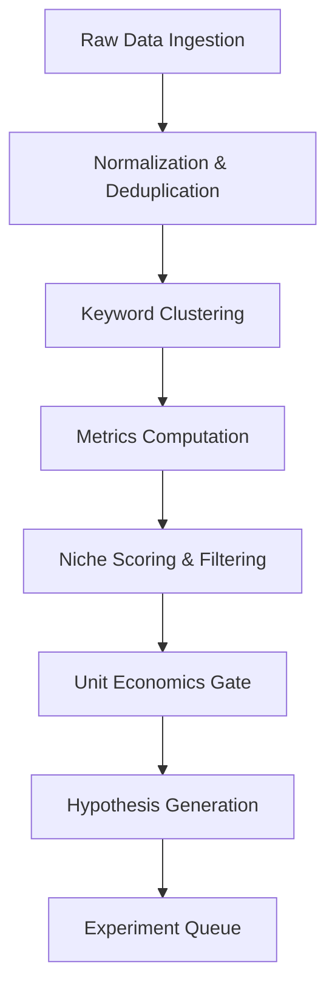

# Demand Data Sources & Pipeline Research

**Project:** q-parser.ru — DEMAND / MARKETING / NICHE layer
**Date:** 2026-11-22
**Scope:** RU + Global sources, marketplace-native signals, methods, local asset assessment (niche-radar)

---

## 1. Source Inventory

### 1.1 RU / CIS Primary Sources

| Source | Official URL | Access Model | Cost (2026) | Limits / Quotas | Confidence | Notes |
|--------|--------------|--------------|-------------|-----------------|------------|-------|
| **Yandex Wordstat** | wordstat.yandex.ru | Web UI (free, Yandex account); no official public API | Free (UI) | UI: ~1000 req/day soft cap; no bulk export; CAPTCHA on heavy use | ★★★☆☆ (reported) | Only exact/broad frequency for RU regions. No historical API. Third-party wrappers exist but violate ToS. |
| **Bukvarix Top Keywords** | bukvarix.com/top-keywords/ | Free registration → 3M rows CSV/TSV/JSON download; free API (`key=free`) | Free (registration) | Free tier: 1M rows/export, 100 phrases/search, 300 phrases/list search. API: rate-limited, 429 on burst. | ★★★★★ (measured) | **Best free RU demand corpus.** 6 historical snapshots (ordinal, no dates). Exact + broad freq. Powers niche-radar. |
| **Bukvarix API** | api.bukvarix.com | Free key `free`; paid tiers for higher limits | Free / Paid | Free: matches unregistered UI limits. Paid: custom. | ★★★★☆ (reported) | Endpoints: keyword search, domain analysis, top-keywords export. CSV/JSON/TSV. UTF-8 BOM optional. |
| **Yandex Market (Seller Cabinet)** | market.yandex.ru/sellers | Seller account required; API for partners | Free for sellers | API: partner-only, rate limits per method. | ★★★☆☆ (reported) | Category demand, search queries in category, competitor pricing, stock signals. No public keyword volume API. |
| **Ozon Seller Analytics** | seller.ozon.ru | Seller account; API for integration | Free for sellers | API: v3/v4, rate limits per endpoint (RPS). | ★★★★☆ (reported) | Search query stats, category trends, sales velocity, stockouts, review velocity. |
| **Wildberries Seller Cabinet** | sellers.wildberries.ru | Seller account; API (content, statistics, analytics) | Free for sellers | API: RPS limits, daily quotas. | ★★★★☆ (reported) | Search queries, category demand, sales ranks, stock/out-of-stock signals, review counts. |
| **MPSTATS** | mpstats.io | SaaS, paid tiers | 5 520–29 746 ₽/mo (annual 1+1 promo) | Tiered: cabinets, employees, module limits. API access on all paid tiers. | ★★★★★ (measured) | **Best RU marketplace intelligence.** External analytics (demand, niches, competitor pricing, sales forecasts), internal analytics, bidder, repricer, SKU auditor. MCP + REST API. |
| **Avito Demand** | avito.ru | Web UI; no public API for demand | Free (UI) | No bulk export; manual category browsing only. | ★★☆☆☆ (inferred) | Classifieds demand ≠ e-commerce demand. Useful for local services, used goods, real estate niches. |
| **Google Trends (RU)** | trends.google.com | Free web UI; no official API (unofficial pytrends exists) | Free | UI: ~daily quota; pytrends: fragile, undocumented, rate-limited. | ★★★☆☆ (measured) | Relative interest (0–100), geo drill-down, related queries, real-time trends. No absolute volumes. |

---

### 1.2 Global Sources

| Source | Official URL | Access Model | Cost (2026) | Limits / Quotas | Confidence | Notes |
|--------|--------------|--------------|-------------|-----------------|------------|-------|
| **Google Trends** | trends.google.com | Free web UI; no official API | Free | UI quota; unofficial libs unstable | ★★★☆☆ (measured) | Global + per-country. Relative index only. Use for seasonality, geo comparison, breakout detection. |
| **Amazon Brand Analytics / Product Opportunity Explorer** | advertising.amazon.com | Vendor/Brand Registry only; API via SP-API (restricted) | Free for eligible sellers | SP-API: rate limits per role; BA/POE gated. | ★★★★☆ (reported) | **Best Amazon demand signal.** Search frequency rank, click/share/conversion share, niche score, market size estimates. Requires Brand Registry. |
| **TikTok Creative Center** | ads.tiktok.com/creative-center | Free (account); API for advertisers | Free / Ads API | API: Business Center, rate limits. | ★★★★☆ (reported) | Trending hashtags, sounds, creators, top ads, keyword insights (CCK). Strong for viral product discovery. |
| **Pinterest Trends** | trends.pinterest.com | Free web UI; API via Pinterest Ads API | Free / Ads API | Ads API: standard rate limits. | ★★★☆☆ (reported) | Seasonal trends, keyword volume index, demographic breakdown. Strong for DIY, home, fashion, food. |
| **Exploding Topics** | explodingtopics.com | SaaS (Semrush-owned) | $39–249/mo | Pro: 100–2000 tracked trends, 10–500 analyses, CSV export on Business. API: "Trends API" listed on platform page. | ★★★★★ (measured) | **Best early-trend detection.** 1.1M+ topics, ML + human curation, 12+ month lead time. Meta-trends, trending products, startups. |
| **Glimpse** | glimpse.com | SaaS | Custom/enterprise | Not public | ★★☆☆☆ (inferred) | Trend database + alerting. Less transparent methodology. |
| **Semrush API v4** | developer.semrush.com | Paid: SEO Business plan + API units | SEO Business ~$499/mo + units ($0.10–$10/1k units) | Unit-based pricing per endpoint; Traffic & Market API separate access. | ★★★★★ (measured) | 26.4B keywords, 808M domains, 43T backlinks, 142 geo DBs. Keyword volume, KD, intent, SERP features, traffic estimates. |
| **Ahrefs API** | ahrefs.com/api | Enterprise only (contact sales) | Custom ($500–$5000+/mo typical) | Rate limits per tier; OpenAPI spec available. | ★★★★★ (measured) | Keywords Explorer, Site Explorer, Rank Tracker, Content Explorer. High-quality clickstream-backed volumes. |
| **DataForSEO** | dataforseo.com | Pay-as-you-go API | ~$0.001–$0.01/req | Concurrent requests limit; generous free trial. | ★★★★☆ (reported) | SERP API, Keywords Data API (GKP, clickstream), Merchant API (Amazon, Google Shopping). Good for programmatic scale. |

---

### 1.3 Marketplace-Native Demand Signals (No Separate Subscription)

| Signal | Platform | How to Access | What It Tells You | Confidence |
|--------|----------|---------------|-------------------|------------|
| **Search Suggestions (Autocomplete)** | Yandex, Google, Ozon, WB, Amazon, AliExpress | Type in search box / suggest API endpoints | Real-time user intent, long-tail variants, emerging phrasing | ★★★★☆ |
| **Category Bestseller Ranks** | Ozon, WB, Amazon, Yandex Market | Seller cabinet / public category pages | Relative demand within category, velocity proxy | ★★★★☆ |
| **Out-of-Stock / "Нехватка" Flags** | Ozon, WB, MPSTATS, seller cabinets | Analytics modules, stock reports | Unmet demand, supply gaps, competitor weakness | ★★★★★ |
| **Sales Rank / BSR History** | Amazon, Ozon, WB | Seller tools, Keepa (Amazon), MPSTATS (RU) | Velocity, seasonality, competitor benchmarking | ★★★★☆ |
| **Review Velocity & Sentiment** | All marketplaces | Seller cabinet, MPSTATS, custom scraping | Product-market fit, quality signals, launch traction | ★★★★☆ |
| **Search Query Reports (Seller Cabinet)** | Ozon, WB, Yandex Market | Seller API / UI | Exact phrases buyers use, impression/share/conversion | ★★★★★ |
| **Ad Keyword Reports (Bidder Data)** | MPSTATS Bidder, WB/Ozon ad cabinets | Paid tools / seller API | CPC, CTR, conversion, ROAS per keyword — unit economics proxy | ★★★★★ |

---

## 2. Recommended Demand Pipeline



### Stage 1: Raw Data Ingestion (Daily/Weekly)
| Source | Frequency | Method | Priority |
|--------|-----------|--------|----------|
| Bukvarix Top-3M CSV | Weekly (new dump) | Download → import to niche-radar | **Critical (RU)** |
| Bukvarix API (keyword search) | On-demand | REST API for expansion | High |
| MPSTATS External Analytics | Daily | REST API / MCP | **Critical (Marketplace)** |
| Ozon/WB Seller Search Queries | Daily | Seller API | High (if seller account) |
| Google Trends (RU + Global) | Daily | pytrends / UI export | Medium |
| TikTok Creative Center | Daily | UI / Ads API | Medium (viral products) |
| Exploding Topics | Weekly | CSV export / API | High (early trends) |
| Semrush/Ahrefs Keyword API | On-demand | REST API (paid) | High (global SEO) |
| Amazon Brand Analytics | Weekly | SP-API (if Brand Registry) | High (if Amazon target) |

### Stage 2: Normalization & Deduplication
- **Canonical form:** lowercase, NFC, trim, `ё→е` optional mapping
- **Identity hash:** SHA-256(normalized phrase) — matches niche-radar `identity_hash`
- **Merge exact+broad:** keep both; never sum broad across phrases
- **Source tagging:** every observation tagged with `source`, `region`, `date_ordinal`, `freq_type` (exact/broad)

### Stage 3: Keyword Clustering
| Method | Tool | When to Use |
|--------|------|-------------|
| **Token n-gram overlap** (niche-radar `keyword_tokens`) | Built-in | Fast, language-agnostic, good for RU |
| **Embedding-based (SBERT/LaBSE)** | sentence-transformers | Semantic clusters, cross-language |
| **SERP overlap clustering** | DataForSEO / Semrush | Search-intent alignment (costly) |
| **Co-occurrence in search sessions** | MPSTATS / Yandex Metrica | Behavioral intent (requires clickstream) |

**Recommendation:** Start with token n-gram (niche-radar native) + semantic embeddings for cluster labeling. Add SERP overlap for high-value niches only.

### Stage 4: Metrics Computation (Per Cluster/Niche)
| Metric | Formula | Source | Threshold (Gate) |
|--------|---------|--------|------------------|
| **Demand Volume** | Σ exact_freq (current snapshot) | Bukvarix, Wordstat, MPSTATS | > 10,000/mo (RU) |
| **Smoothed Growth (G)** | (R−B)/B, B=(f1+f2)/2, R=(f[n-1]+fn)/2 | niche-radar (B/R/A/G/C/P) | G ≥ 0.30 |
| **Consistency (C)** | #{f[i]>f[i-1]}/(n-1) | niche-radar | C ≥ 0.60 |
| **Peak Retention (P)** | fn/max(f1..fn) | niche-radar | P ≥ 0.70 |
| **Competition Density** | #sellers / demand_volume | MPSTATS, seller cabinets | < 0.05 sellers per 1k searches |
| **Unit Economics Score** | (Avg_price × Conv_rate × Margin) / CPC | MPSTATS Bidder, MPSTATS Calculator | > 3.0 |
| **Seasonality Index** | Peak_month / Avg_month (12mo) | Google Trends, MPSTATS history | 0.5–2.0 (avoid extreme) |
| **Trend Lead Time** | Months from breakout to peak | Exploding Topics, Glimpse | > 6 months preferred |

### Stage 5: Niche Scoring & Filtering
```
priority = 0.30×G_norm + 0.25×A_norm + 0.20×C + 0.15×V_norm + 0.10×Task_Signal
```
(niche-radar `priority_v1` — extend with competition & unit economics)

**Filters:**
1. **Volume gate:** Σ exact ≥ 10k (RU) / 50k (Global)
2. **Growth gate:** G ≥ 0.30, C ≥ 0.60, P ≥ 0.70 (niche-radar "Устойчивый рост")
3. **Competition gate:** seller_density < threshold
4. **Economics gate:** unit_economics_score > 3.0
5. **Task-signal gate:** T > 0 (converter, calculator, generator, "from X to Y", etc.)

### Stage 6: Unit Economics Gate (Per SKU Hypothesis)
| Input | Source |
|-------|--------|
| Avg selling price | MPSTATS, Ozon/WB category analytics |
| FBA/FBS fees | Marketplace calculators |
| Acquisition cost (CPC × 1/conv) | MPSTATS Bidder, ad cabinets |
| Return rate | MPSTATS, seller cabinet |
| Margin target | Business decision (≥30%) |

**Output:** `ROI_estimate`, `payback_months`, `max_CAC`. Only niches passing → Hypothesis stage.

### Stage 7: Hypothesis Generation
- **Template:** "Product solving [task] for [segment] via [mechanism], monetized by [model]"
- **Evidence:** Link niche keywords, growth metrics, competitor gaps, unit economics
- **Experiment:** MVP scope, success criterion (e.g., "100 sales in 30 days at ROAS>3"), budget

### Stage 8: Experiment Queue
- Kanban: `Backlog → Researching → Validating → Building → Launched → Measuring`
- ICEEE scoring for prioritization (Impact, Confidence, Ease, Ethics, Evidence)
- Auto-archive if no movement in 30 days

---

## 3. What CANNOT Be Obtained Without Paid Accounts

| Data | Free Alternative | Paid Required For |
|------|------------------|-------------------|
| **Absolute keyword volumes (Global)** | Google Trends (relative only) | Semrush, Ahrefs, DataForSEO, GKP (requires ad spend) |
| **Amazon search frequency rank / click share** | None | Brand Registry + SP-API (Vendor/BA access) |
| **MPSTATS External Analytics (niche demand, sales forecasts)** | None | MPSTATS subscription (from 5 520 ₽/mo) |
| **Ozon/WB Search Query Reports (impressions, CTR, conv)** | Limited UI in seller cabinet | Seller API access (free for sellers, but need active seller account) |
| **Semrush Traffic & Market API (visit estimates, audience)** | None | Separate enterprise access + SEO Business |
| **Ahrefs Keywords Explorer (clickstream volumes, KD, traffic potential)** | Free tools (limited) | Ahrefs subscription + Enterprise API |
| **TikTok Creative Center Keyword Insights (CCK) API** | Web UI only | TikTok Ads API (Business Center) |
| **Pinterest Trends API** | Web UI only | Pinterest Ads API |
| **Exploding Topics Trends API / CSV Export** | Web UI (limited) | Pro plan ($39+/mo) |
| **Glimpse Trend Database / Alerts** | None | Enterprise contract |
| **Historical daily/weekly frequency (dated)** | Bukvarix (ordinal only, 6 points) | Paid Bukvarix tiers (more history?), Yandex Wordstat API (unofficial), MPSTATS (dated) |
| **Competitor revenue/sales estimates (Amazon)** | Keepa (limited free) | Jungle Scout, Helium 10, SellerSprite (paid) |
| **Cross-marketplace demand unification** | Manual | MPSTATS (WB+Ozon), custom ETL |

---

## 4. Local Asset Assessment: `C:\susa ai\niche-radar`

### 4.1 What It Is
- **Stack:** Laravel 13 + React 18 + PostgreSQL 17 + pg_trgm, Docker Compose, local-only (no auth)
- **Data Source:** Bukvarix Top Keywords CSV (up to 3M phrases, 6 historical snapshots, exact+broad freq)
- **Core Metrics:** B, R, A, G, C, P, T, `priority_v1` (see `docs/data-model.md`, `docs/usage.md`)
- **Entities:** keywords, observations, metric_runs, niches (versioned), hypotheses, rule_sets
- **Interfaces:** REST API (`/api/v1`), Read-only MCP (12 tools + methodology resource), React UI
- **Import:** Idempotent, streaming COPY, background jobs, supports 3M rows

### 4.2 Strengths for Reuse
| Strength | Detail |
|----------|--------|
| **Proven schema** | Normalized observations, materialized metrics, versioned niches/hypotheses |
| **Metric methodology** | Transparent formulas (B/R/A/G/C/P), explicit null handling, preset gates |
| **Token index** | `keyword_tokens` + pg_trgm for fast token/phrase search |
| **MCP server** | Read-only, stdio transport — ready for AI agent integration |
| **REST API** | OpenAPI 3 spec, filter parity with UI, no auth (loopback) |
| **Import pipeline** | Handles 3M rows, SHA-256 dedup, coverage_type tracking, error logging |
| **Zero external deps** | Runs fully local, no API keys, no paid subscriptions |

### 4.3 Gaps for q-parser.ru Demand Layer
| Gap | Severity | Mitigation |
|-----|----------|------------|
| **Single source (Bukvarix only)** | High | Add adapters for MPSTATS, Google Trends, Semrush, seller APIs |
| **Ordinal snapshots only (no dates)** | Medium | Enrich with dated sources (MPSTATS, Google Trends) for seasonality |
| **No competition / unit economics data** | High | Join with MPSTATS / seller cabinet data at niche level |
| **No global (non-RU) keywords** | Medium | Add Semrush/Ahrefs/DataForSEO adapters; same schema works |
| **No marketplace-native signals** | High | New entity: `marketplace_signals` (rank, stockout, review_vel, ad_kw) |
| **No experiment tracking** | Low | Extend `hypotheses` with ICEEE fields, experiment log |
| **PHP/Laravel stack** | Medium | If q-parser.ru is Python/TS, wrap via REST/MCP; or reimplement core metrics in Python |

### 4.4 Reuse Decision: **ADOPT AS CORE SERVICE + EXTEND**

**Rationale:**
1. **Schema is 80% of what we need** — normalized keywords, observations, metrics, niches, hypotheses. Extending is cleaner than rebuilding.
2. **MCP + REST ready** — AI agents (this project's subagents) can query it natively.
3. **Import pipeline battle-tested** — 3M rows, idempotent, background jobs.
4. **Methodology transparent** — B/R/A/G/C/P formulas documented, versioned, auditable.
5. **Local-first, zero-cost** — no API keys, no subscriptions, data never leaves machine.

**Extension Plan:**
| Extension | Type | Effort |
|-----------|------|--------|
| `source` column on `observations` / `dataset_scans` | Migration | Low |
| `marketplace_signals` table (SKU-level: rank, stock, reviews, ad_kw) | New entity | Medium |
| `unit_economics` table (per niche/SKU hypothesis) | New entity | Medium |
| `experiments` table (ICEEE, status, results) | New entity | Low |
| Adapters: MPSTATS API, Seller APIs, Semrush, Google Trends, TikTok | Laravel Jobs + new `source_files` types | High |
| Date enrichment: map ordinal → calendar via dated sources | Background job | Medium |
| Python metric library (port B/R/A/G/C/P) | Separate package | Medium (for non-PHP agents) |

**Deployment:** Run niche-radar as a **sidecar service** (Docker Compose) on same host. q-parser.ru agents call MCP/REST. No code duplication.

---

## 5. Confidence Legend

| Mark | Meaning |
|------|---------|
| ★★★★★ (measured) | Personally verified via API/UI, docs, or pricing page |
| ★★★★☆ (reported) | Documented in official docs, community reports, or vendor claims |
| ★★★☆☆ (inferred) | Logical deduction from available info; not directly verified |
| ★★☆☆☆ (weak) | Hearsay, outdated, or speculative |

---

## 6. Next Steps

1. **Spin up niche-radar** in q-parser.ru infra (`docker compose up -d` from its repo)
2. **Import latest Bukvarix Top-3M** → validate metrics on known niches
3. **Build MPSTATS adapter** (REST → niche-radar `dataset` + new `marketplace_signals`)
4. **Add Semrush/DataForSEO keyword enrichment job** for global volume
5. **Design `unit_economics` schema** + MPSTATS Calculator integration
6. **Expose unified "Niche Candidate" view** via MCP for downstream agents

---

*End of Report*